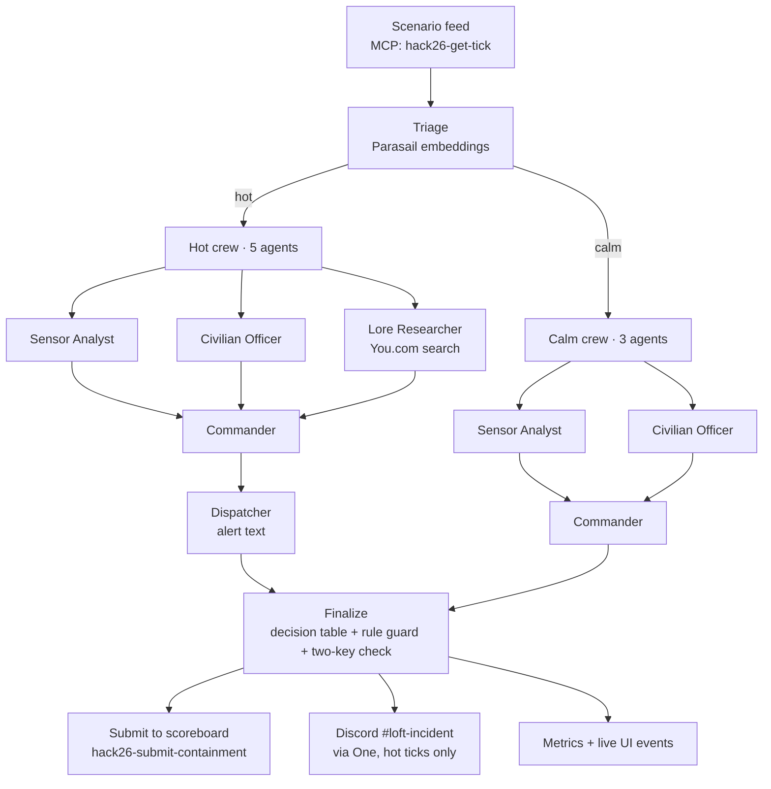

# Watchtower — Team Spooky

**Hack with YOU: Halloween Edition · Track 1: The Exorcism Protocol**
AWS Builder Loft, San Francisco · October 28, 2026

Watchtower is a supervised AI incident response platform for a live facility simulation. For every incident tick it triages each sector, sends a team of agents with **partial knowledge** to analyze it, decides **contain / evacuate / observe**, submits the decision to the scenario scoreboard, raises a Discord alert only when two agents agree it is serious, and records tokens, cost and latency for every tick.

Built with **CrewAI** · **Parasail** · **You.com** · **One** · venue by AWS

---

## How it works



1. **Fetch** a tick from the scenario MCP server (or the published fixtures when the feed is down).
2. **Triage** each sector with Parasail embeddings against calm and danger examples. Hot ticks go to the full crew; calm ticks go to a lighter crew with no research and no alert.
3. **Analyze in parallel.** Each agent sees only its slice of the tick:
   - **Sensor Analyst** sees EMF, temperature, motion and sightings.
   - **Civilian Officer** sees civilian status and containment state.
   - **Lore Researcher** sees only the entity class, plus live You.com evidence with source URLs.
4. **Decide.** The Commander chooses an action from the team's reports. The agents' structured findings go through a fixed decision table (people at risk in a hot sector → evacuate; hot with no one at risk → contain; nothing hot → observe), and a deterministic rule guards against disagreement to prevent false alarms.
5. **Act.** Every tick is submitted to the scoreboard. A Discord alert is drafted only when the Sensor Analyst says the sector is hot **and** the Commander marks it serious (two-key check).
6. **Measure.** Tokens and cost per model, You.com searches, latency, agents used vs. budget, score and false alarms are printed per tick, streamed to the UI and saved to `metrics.json`.

## How each partner is used

| Partner | Role in Watchtower |
|---|---|
| **CrewAI** | The swarm: a Flow with a router (`triage → hot/calm → finalize`), 5 role-based agents, parallel tasks, structured Pydantic outputs |
| **Parasail** | Every agent's model (three models split by job), schema-locked JSON for the backup Commander, and embeddings for sector triage |
| **You.com** | Live web grounding for the Lore Researcher: a guaranteed search per hot tick plus a search tool the agent can call, with cited source URLs |
| **One** | Real action: posts the incident alert to the venue's `#loft-incident` Discord channel (`src/tools/one_discord.py`) |

## Agents and models

| Agent | Sees | Parasail model | Output |
|---|---|---|---|
| Sensor Analyst | sensors, sightings | `parasail-glm-53-flash` | hot / not hot per sector |
| Civilian Officer | civilian status, containment | `parasail-minimax-m31-flash` | at risk / not per sector |
| Lore Researcher | entity class + You.com evidence | `parasail-glm-53-flash` | entity summary, countermeasures, sources |
| Commander | the three reports | `parasail-deepseek-v41-flash` | action, sector, rationale, serious |
| Dispatcher | everything above | `parasail-minimax-m31-flash` | one-line alert |

The reasoning model is reserved for the final call; cheaper flash models handle the narrow jobs. Models are configurable in `.env`.

## Reliability

- **Budget aware:** reads `max_active_agents` from every tick; drops research first if over budget.
- **Retries:** each model call retries on overload or rate limits; if a whole tick fails (overload, timeout or malformed JSON), it is retried once on a backup Parasail model.
- **Never loses a tick:** if the swarm still fails, the deterministic rule decides, so every tick gets a correct answer.
- **Feed outages:** decisions can be queued (`--dry-run`) and replayed to the scoreboard later (`--replay`).

## Quick start

Requires **Python 3.10–3.13** (CrewAI does not support 3.14).

```bash
git clone https://github.com/rohith-200/HackwithYOU_Team_Spooky.git
cd HackwithYOU_Team_Spooky
python3.12 -m venv .venv && source .venv/bin/activate
pip install -r requirements.txt
cp .env.example .env        # then fill in your keys
python main.py --crew       # run the swarm on the fixtures (nothing is submitted)
```

### `.env`

```properties
# keys
YDC_API_KEY=
PARASAIL_API_KEY=
ONE_API_KEY=

# event
TEAM_HANDLE=team-spooky
TEAM_TOKEN=
SCENARIO_MCP=https://api.you.com/mcp/halloween-hack-26
DISCORD_CHANNEL_ID=1564842098740695100
UI_URL=http://localhost:8000

# Parasail
PARASAIL_BASE_URL=https://api.parasail.io/v1
PARASAIL_MODEL=parasail-glm-53-flash
PARASAIL_FALLBACK_MODEL=parasail-minimax-m31-flash
PARASAIL_EMBEDDING_MODEL=parasail-bge-m3
MODEL_FAST=parasail-glm-53-flash
MODEL_CHEAP=parasail-minimax-m31-flash
MODEL_REASON=parasail-deepseek-v41-flash

CREWAI_TRACING_ENABLED=false
```

Never commit `.env`.

### Run modes

| Command | What it does |
|---|---|
| `python main.py` | Rule-only decisions on the fixtures; nothing submitted |
| `python main.py --crew` | Full swarm on the fixtures; nothing submitted |
| `python main.py --crew --live --dry-run` | Swarm on live ticks; decisions queued, not submitted |
| `python main.py --replay` | Submit queued decisions to the live scoreboard |
| `python main.py --crew --live` | Swarm on live ticks, submitting each decision |
| `python main.py --crew --submit-fixtures` | Swarm on the fixture ticks, submitting to the live scoreboard |

The scoreboard accepts **one answer per tick**, so the first submission is final.

Useful checks:

```bash
python scripts/probe_feed.py     # list the scenario MCP tools and read the scoreboard
python -m src.llm                # quick Parasail check (if using a get_llm-based llm.py)
```

---

*Event: [Hack with YOU — Halloween Edition](https://youdotcom-oss.github.io/halloween-hack-2026/)*
